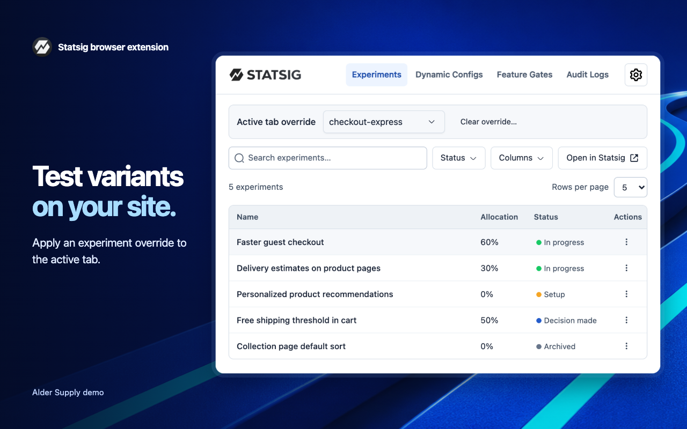

# Statsig Features and Experimentation

Test a Statsig experiment variant on the page you’re working on. Use the browser toolbar to apply test overrides, inspect rollout settings, and see what changed in your project.

[Install for Chrome](https://chromewebstore.google.com/detail/statsig-features-and-expe/doialjibpidkdpdneplcnmkbdojpagdd) · [Install for Firefox](https://addons.mozilla.org/en-US/firefox/addon/statsig-experimentation/)



## Quick start

1. Open the extension and connect with a **Console API key** from your project settings. [Statsig Console API setup](https://docs.statsig.com/console-api/introduction#authorization)
2. To test an override, open your site and go to **Settings → Override storage** in the extension. Choose **Local storage** or **Cookie**, enter the key your site reads for its Statsig ID, and save.
3. Open an experiment or feature gate and select a configured override ID. The extension writes the ID to your chosen storage and reloads the active tab. Use **Clear override** to remove the stored ID and reload again.

A **read-only** key lets you browse and apply existing override IDs. To create or delete experiment overrides or rename experiment groups, connect with a **read/write** key and select **Read and write** under **Settings → Console key type**.

## What you can inspect

- **Experiments** — allocation, group splits, parameters, hypotheses, health checks, and configured metrics.
- **Feature Gates** — pass rates, targeting condition types, environments, and configured overrides.
- **Dynamic Configs** — config details and default values you can copy as JSON.
- **Audit Logs** — who changed what and when, with before-and-after rule snapshots where available.
- **User details** — the Statsig SDK identity and custom properties on the active page, when available. Open it from the settings menu.

## Development

Clone the repository and use Node.js 24. Run these commands from the repository root.

```sh
npm ci
npm run dev
```

In Chrome, open `chrome://extensions`, enable **Developer mode**, and select **Load unpacked**. Choose `build/chrome-mv3-dev`.

To develop in Firefox, run `npm run dev -- --browser firefox`. Open `about:debugging#/runtime/this-firefox`, choose **Load Temporary Add-on**, and select `build/firefox-mv3-dev/manifest.json`. [Firefox temporary installation guide](https://extensionworkshop.com/documentation/develop/temporary-installation-in-firefox/)

Run the checks used in CI before opening a pull request.

```sh
npm run typecheck
npm run lint
```

### Production builds

| Browser | Command | Package |
| --- | --- | --- |
| Chrome | `npm run build` | `build/chrome-mv3-prod.zip` |
| Firefox | `npm run build -- --browser firefox` | `build/firefox-mv3-prod.zip` |

To test a production build locally, load `build/chrome-mv3` in Chrome or `build/firefox-mv3/manifest.json` in Firefox using the same browser steps above.

## Support and contributions

Report bugs or suggest improvements in [GitHub Issues](https://github.com/aaron5670/statsig-browser-extension/issues). For bug reports, include your browser, extension version, and steps to reproduce.

This project is developed independently of Statsig.
